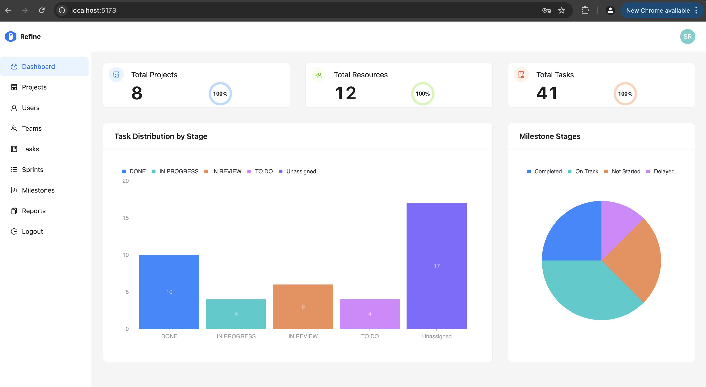
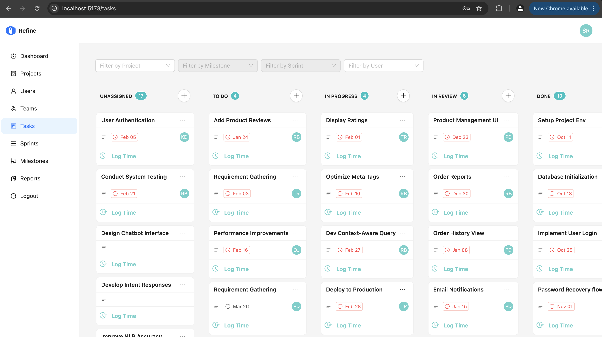
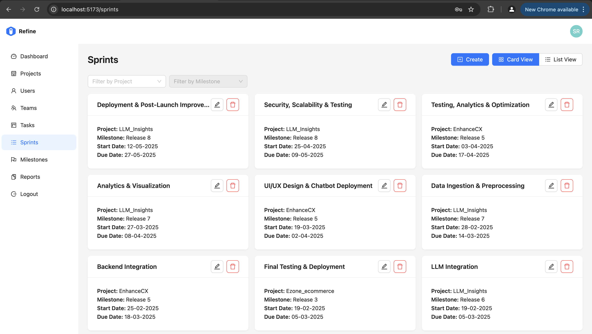
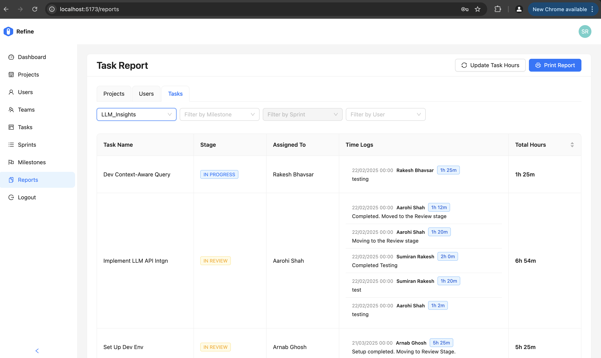
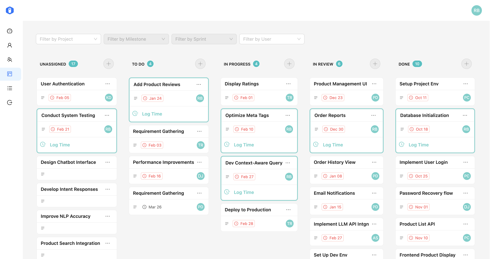

# Project Management System with Kanban Board & RBAC

_Developed as the capstone project for the Master of Computer Applications (MCA) program._

A comprehensive project management application built with **React**, **Refine**, and **Supabase** that provides task tracking, milestone management, sprint planning, and detailed reporting capabilities with Role-Based Access Control (RBAC).

This application streamlines project management workflows by offering an intuitive Kanban board interface, sprint and milestone planning tools, and robust reporting features.

---

## Key Features

- **Kanban Board:** Interactive board for visual task tracking with drag-and-drop workflows
- **Sprint & Milestone Planning:** Schedule and track team deliverables
- **Reporting & Analytics:** Comprehensive project, user, and task reporting
- **Role-Based Access Control (RBAC):** Granular permissions for Project Managers vs. Team Members
- **Time Tracking & Estimation:** Monitor project progress and time allocation
- **Team Management:** Collaborative tools tailored for cross-functional teams

---

## Tech Stack & Architecture Highlights

| Layer                       | Technology                          |
| :-------------------------- | :---------------------------------- |
| **Frontend Framework**      | React + Refine Framework            |
| **Backend & Database**      | Supabase (PostgreSQL, Auth)         |
| **State & Data Fetching**   | React Query / Refine Data Providers |
| **UI Components & Styling** | Ant Design                          |
| **Version Control & CI/CD** | Git, GitHub                         |

---

## Application Screenshots

### 1. Project Manager Dashboard



---

### 2. Kanban Board (Project Manager View)



---

### 3. Sprints Card View



---

### 4. Reports & Analytics



---

### 5. Team Member View & Task Cards



---

## Quick Start Guide

### Prerequisites

- **OS:** Linux / macOS / WSL
- **Node.js:** v18 or higher

### Installation & Setup

1. **Clone the repository and navigate to the project directory:**

   ```bash
   git clone [https://github.com/polz24/project-management-system.git](https://github.com/polz24/project-management-system.git)
   cd project-management-system

   ```

2. **Run setup scripts:**

#### Initial setup & dependency installation

./install.sh

#### Start the development server

./start.sh

3. **Access the Application:**
   Open your browser and navigate to http://localhost:5173/
